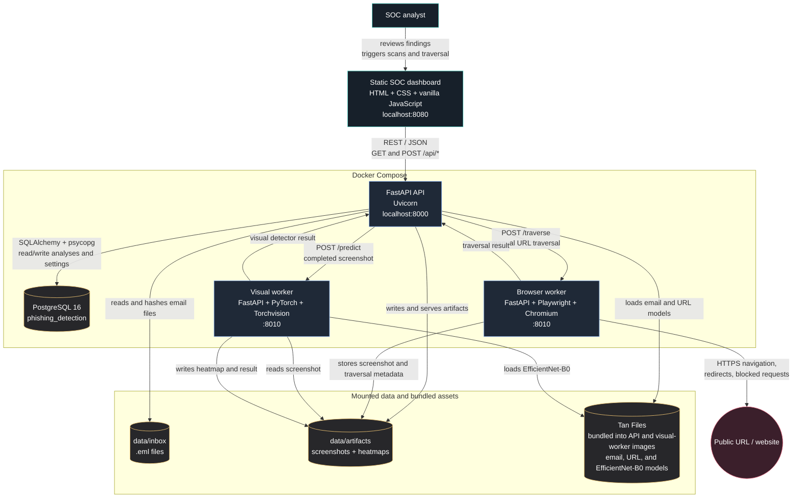

# System Architecture

The platform is deployed as a static dashboard plus three containerized backend
services. The API owns ingestion, orchestration, risk aggregation, and
persistence. Browser traversal and visual analysis run in separate workers so
that URL browsing and image inference remain isolated from the main API.

## Main analysis flow

1. The dashboard sends an ingestion request to the API.
2. The API reads `.eml` files from `data/inbox`, parses them, extracts URLs and
   attachments, and runs the configured email and URL detectors.
3. Detector results, explanations, risk weights, and email metadata are stored
   in PostgreSQL.
4. An analyst can manually request traversal for a selected URL. The API
   delegates browsing to the Playwright browser worker.
5. The browser worker follows redirects, records blocked requests, and captures
   a screenshot under `data/artifacts`.
6. The API sends the completed screenshot to the visual worker. The PyTorch
   worker produces visual analysis and a heatmap, which are stored as
   traversal-specific artifacts.
7. The dashboard polls the API and displays aggregate risk, evidence,
   screenshots, and visual explanations.

## Runtime boundaries

- `db-net` connects the API to PostgreSQL.
- `app-net` connects the API to the browser and visual workers.
- The browser worker is isolated from the public dashboard and is only exposed
  internally to the Compose network.
- PostgreSQL data is persisted in the `phishing-postgres-data` Docker volume.
- Inbox files, screenshots, and heatmaps are shared through the repository's
  mounted `data` directory. Model files from `Tan Files` are copied into the
  API and visual-worker images at build time.
